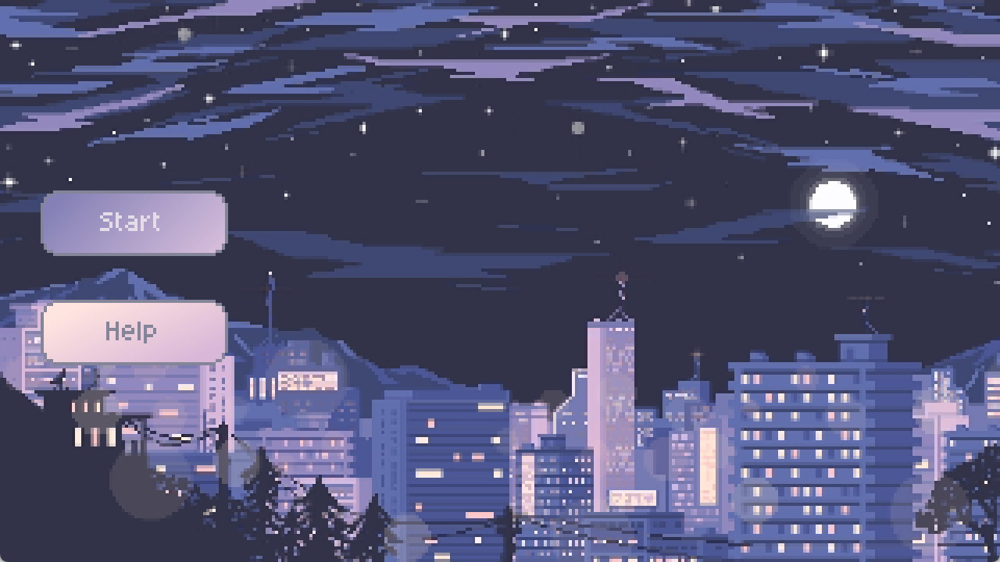
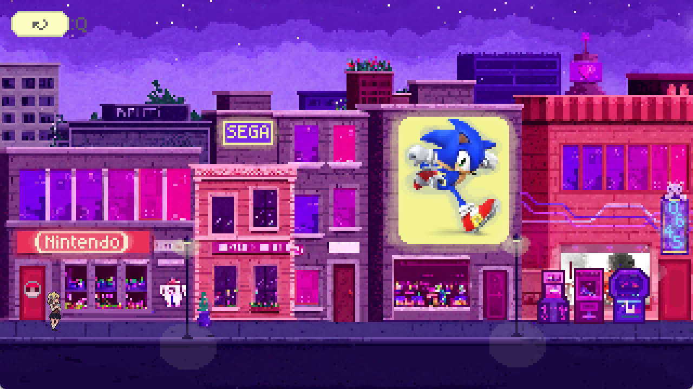
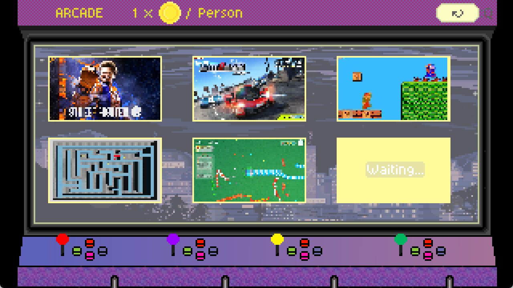
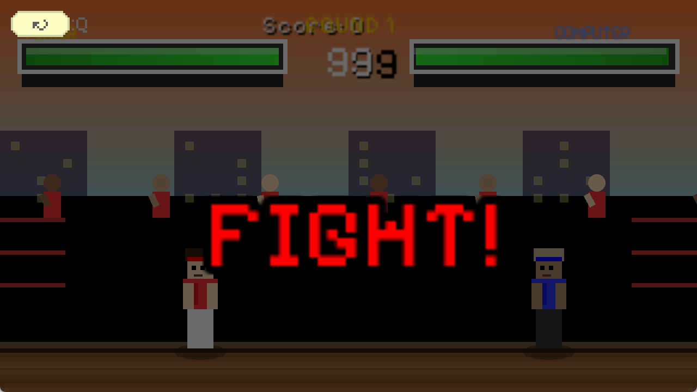
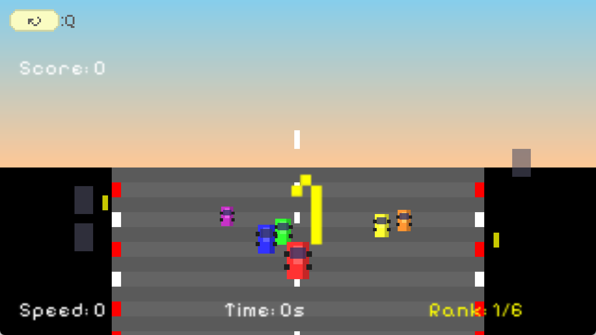
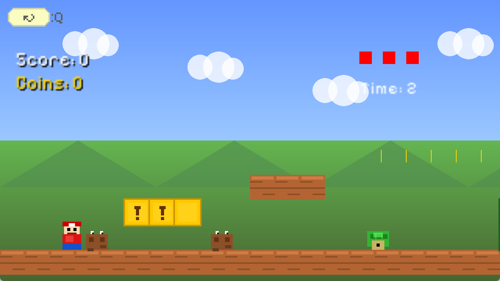
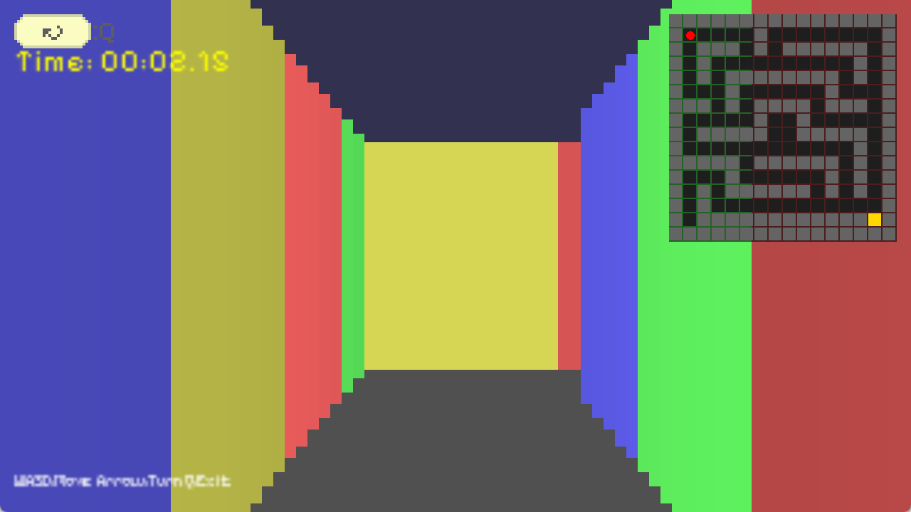
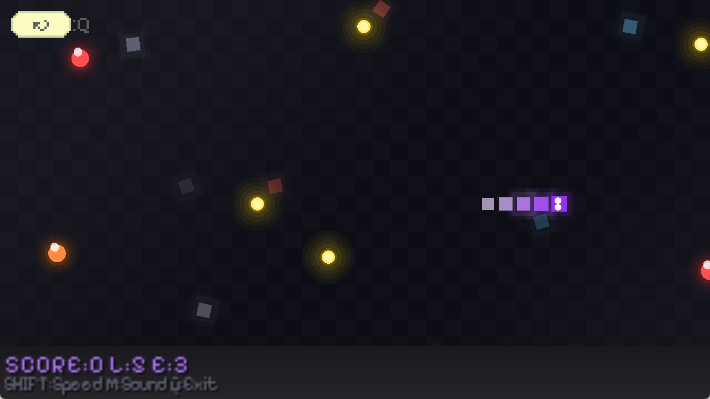

# 街机模拟器（Arcade Simulator）

> 一款使用 C++ 和 SFML 制作的像素风街机模拟游戏，作为大学 C++ 课程作业开发。

## 项目信息

| 项目 | 内容 |
| --- | --- |
| 项目名称 | Arcade Simulator（窗口标题：Street Arcade Game） |
| 版本 | v1.0 |
| 技术栈 | C++ + SFML 2.x（Graphics / Audio / Window / System） |
| 平台 | Windows（MinGW 构建） |

## 游戏简介

玩家在一条夜晚的街道场景中自由行走，进入街机厅后可以选择并游玩 5 款内置小游戏：

1. **格斗游戏**（街霸风格）—— 玩家 vs AI 的 2 回合制格斗
2. **赛车游戏** —— 伪 3D 竞速，60 秒内争夺排名
3. **超级马里奥**（平台跳跃）—— 横版卷轴平台闯关
4. **3D 迷宫** —— 基于光线投射（Raycasting）的第一人称迷宫
5. **贪吃蛇** —— 带敌人、障碍物和道具的增强版贪吃蛇

## 游戏截图

| 场景 | 截图 |
| --- | --- |
| 主菜单 |  |
| 街道场景 |  |
| 街机选择 |  |
| 格斗游戏（街霸风格） |  |
| 赛车游戏 |  |
| 超级马里奥 |  |
| 3D 迷宫 |  |
| 贪吃蛇 |  |

## 目录结构

```
Arcade Simulator/
├── assets/                 # 游戏资源（美术、音效、字体，均为作者自制）
│   ├── audio/              # 音效与背景音乐（.ogg）
│   ├── fonts/              # 字体（PixelifySans.ttf）
│   └── images/             # 图片（场景背景、按钮、精灵表等）
│   ├── scene1/             # 主菜单场景图片
│   ├── scene2/             # 街道场景图片（含精灵动画表）
│   └── scene3/             # 街机选择场景图片
├── bin/                    # 可执行文件与依赖 DLL
│   └── ArcadeSimulator.exe
├── src/                    # 源代码
├── docs/                   # 项目文档（设计文档 + 技术文档）
├── info.txt                # 项目说明文件
└── README.md               # 本文件
```

## 快速开始

### 直接运行

双击 `bin/ArcadeSimulator.exe` 即可启动游戏（请保持 `bin/` 目录内的 DLL 完整，且 `assets/` 目录与可执行文件处于同一上级目录下，因为代码中使用的是 `../assets/...` 相对路径）。

### 从源码编译

项目未附带构建脚本，可使用 g++（MinGW）手动编译，示例：

```bash
cd src
g++ -std=c++17 -O2 \
    main.cpp Game.cpp SceneManager.cpp Scene1.cpp Scene2.cpp Scene3.cpp \
    Button.cpp SpecialButton.cpp Camera.cpp Player.cpp NPC.cpp NPCManager.cpp \
    SpriteSheet.cpp ResourceManager.cpp Game1.cpp Game2.cpp Game3.cpp \
    Game4.cpp Game5.cpp TestScene.cpp TestSpriteScene.cpp \
    -I<SFML/include> -L<SFML/lib> \
    -lsfml-graphics -lsfml-audio -lsfml-window -lsfml-system \
    -o ../bin/ArcadeSimulator.exe
```

> 提示：编译后将可执行文件放置在 `bin/` 目录下，并从 `bin/` 目录启动，以确保 `../assets/...` 相对路径正确解析。

## 操作说明（汇总）

| 位置 | 操作 | 说明 |
| --- | --- | --- |
| 主菜单 | 鼠标点击 / `Q` | 选择「开始游戏」或「帮助」 |
| 街道场景 | `A` / `D` | 左右移动玩家 |
| 街道场景 | `F` | 在街机厅交互区域（X 240–300）内进入街机选择界面 |
| 街道场景 | `Q` 或点击返回按钮 | 返回主菜单 |
| 街机选择 | 鼠标点击 | 选择 1–6 号小游戏 |
| 街机选择 | `Q` | 返回街道场景 |
| 所有小游戏 | `Q` 或点击返回按钮 | 退出到街机选择界面（`ESC` 效果相同） |

各小游戏的具体操作见 [docs/设计文档.md](docs/设计文档.md)。

## 文档

- **设计文档**：[docs/设计文档.md](docs/设计文档.md) —— 游戏设计、场景流程、小游戏玩法、资源清单、操作说明
- **技术文档**：[docs/技术文档.md](docs/技术文档.md) —— 架构设计、类设计、核心系统、构建指南
